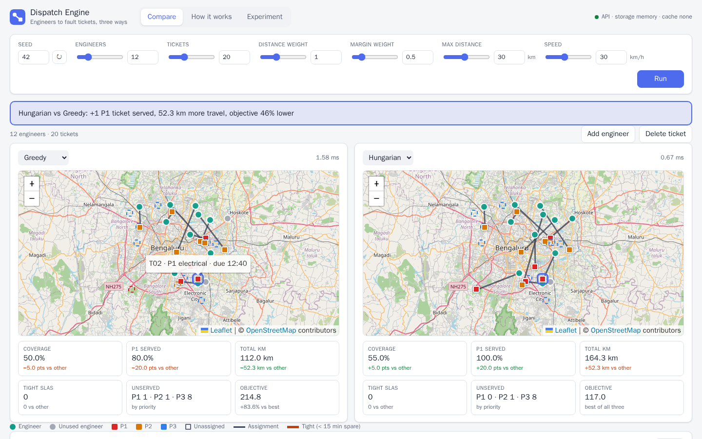
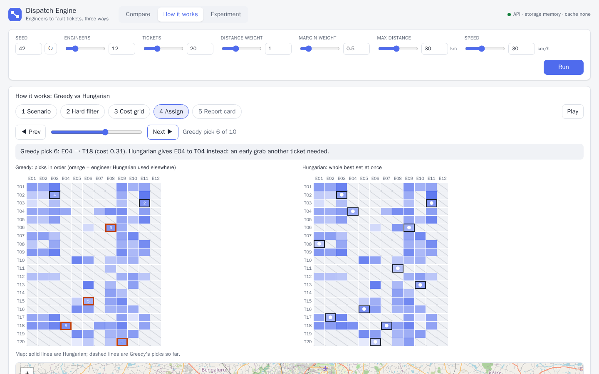
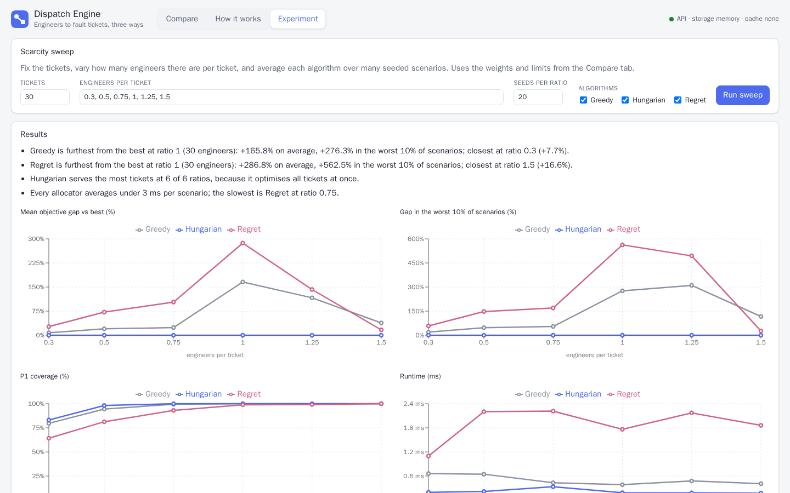

# Dispatch Engine: Resource Allocation for Field Service

Assigns maintenance engineers in Bengaluru to equipment fault tickets, and compares three
allocation algorithms (Greedy, Hungarian, Regret) on the same input. Each one is shown on a
map, side by side, with plain-words reasons for every decision and a report card per algorithm.

**Stack:** FastAPI + NumPy/SciPy (`api/`) · React 18 + Vite + Leaflet/OpenStreetMap (`ui/`) ·
free and open source only, no API keys.



| How it works: Greedy's picks vs Hungarian's full set | Experiment: the scarcity sweep |
| --- | --- |
|  |  |

## Quick start

The only thing you need is **Docker Desktop** (free). No Python, Node or database to install.
The first start downloads about 600 MB and takes a few minutes; later starts take seconds.

### Windows

1. **Install Docker Desktop** from
   [docs.docker.com/desktop/setup/install/windows-install](https://docs.docker.com/desktop/setup/install/windows-install/).
   Open it and wait until it shows **Engine running**.
2. **Get the code.** Open **PowerShell** and run:

   ```powershell
   git clone https://github.com/DB00708/dispatch-engine.git
   cd dispatch-engine
   ```

   No Git? On the GitHub page click **Code → Download ZIP**, unzip it, then open PowerShell in
   that folder (in File Explorer, right-click inside the folder → *Open in Terminal*; on
   Windows 10: Shift + right-click → *Open PowerShell window here*).
3. **Start the app:**

   ```powershell
   .\run.cmd
   ```

   When it is ready, your browser opens **http://localhost:8080**. You can also just
   double-click `run.cmd` in File Explorer.
4. **Stop it** when you are done:

   ```powershell
   .\run.cmd stop
   ```

To run every test and check: `.\run.cmd check`.

### Mac

1. **Install Docker Desktop for Mac** (Apple chip or Intel) from
   [docs.docker.com/desktop/setup/install/mac-install](https://docs.docker.com/desktop/setup/install/mac-install/).
   Open it from Applications and wait until it shows **Engine running** (the whale icon
   appears in the menu bar).
2. **Get the code.** Open **Terminal** and run:

   ```bash
   git clone https://github.com/DB00708/dispatch-engine.git
   cd dispatch-engine
   ```

   The first time you use `git`, macOS may offer to install the command line developer tools:
   click **Install**, then run the commands again. No Git? Use **Code → Download ZIP** on the
   GitHub page, unzip it, and `cd` into the folder.
3. **Start the app:**

   ```bash
   ./run.sh
   ```

   When it is ready, your browser opens **http://localhost:8080**.
4. **Stop it** when you are done:

   ```bash
   ./run.sh stop
   ```

To run every test and check: `./run.sh check`.

**Linux:** the same as Mac, with Docker Engine and the Compose plugin instead of Docker Desktop.

### All commands

| | Windows | Mac / Linux |
| --- | --- | --- |
| Start the app | `.\run.cmd` | `./run.sh` |
| Run every check | `.\run.cmd check` | `./run.sh check` |
| Stop | `.\run.cmd stop` | `./run.sh stop` |
| Follow the logs | `.\run.cmd logs` | `./run.sh logs` |

- **API docs:** http://localhost:8080/docs
- **Port 8080 taken?** It picks the next free port (8081, 8082, ...) and prints the address.
- **Postgres + Redis:** add `--db`, for example `.\run.cmd --db` or `./run.sh --db`.

**Without Docker** (Python 3.11+ and Node 22.12+), in two terminals:

```bash
cd api && pip install -r requirements.txt && uvicorn app.main:app --reload    # API on :8000
cd ui && npm install && npm run dev                                           # UI on http://localhost:5173
```

### Troubleshooting

| You see | Do this |
| --- | --- |
| "Docker is installed but not running" | Start Docker Desktop, wait until it says "Engine running", run the command again |
| "Docker is not installed" | Install Docker Desktop from the link above |
| "permission denied: ./run.sh" (Mac/Linux) | Run `bash run.sh` instead (happens after a ZIP download) |
| "running scripts is disabled on this system" (Windows) | Use `.\run.cmd`, which handles this for you |
| The page is blank or an old version | `./run.sh stop`, then `./run.sh` again (`.\run.cmd` on Windows) |
| Something else | `./run.sh logs` (or `.\run.cmd logs`) shows what each container is doing |

## Check everything

`./run.sh check` (`.\run.cmd check` on Windows) runs every check in Docker and finishes with
a pass/fail line per check. Add `--db` to run them against Postgres + Redis. The first run
also downloads the Playwright browser image (about 3.6 GB on disk).

| Check | What runs |
| --- | --- |
| API | ruff, strict mypy, 202 pytest unit/algorithm/API tests (warnings fail the run) |
| UI | ESLint (zero warnings), TypeScript, 21 Vitest tests, production build |
| API e2e | 11 tests against the running API, directly and through nginx |
| UI e2e | 12 Playwright tests in Chromium (any console error or warning fails) |
| Logs | no warnings or errors in any container |

## Approach

- **Domain:** engineers (location, shift, skills, experience) and fault tickets (location,
  fault type, priority P1–P3, deadline). One engineer does one ticket per dispatch round.
- **Hard rules:** skill match, inside the shift, before the deadline, within 30 km, one
  ticket per engineer.
- **Soft cost:** weighted distance plus a penalty for a thin deadline margin. Leaving a ticket
  unserved costs 100 / 30 / 10 for P1 / P2 / P3, so every algorithm drops a P3 before a P1.
- **Algorithms:** all three read one shared cost grid.
  - **Greedy:** the most urgent ticket takes its cheapest free engineer.
  - **Hungarian:** the optimal batch assignment, using one dummy "unassigned" column per ticket.
  - **Regret:** serves first the ticket that would lose most by waiting.
- **Explanations:** each assignment says why that engineer, and lists the runner-ups with
  "+4.2 km" or "lacks hydraulic skill". Each unserved ticket says why nobody could take it.
- **Metrics:** coverage, P1 coverage, km, deadline margin, tight jobs, objective, gap vs best,
  runtime. A separate validator re-checks every result against the raw scenario.

Details: [api/README.md](api/README.md) (engine, API contract, assumptions) and
[ui/README.md](ui/README.md) (screens, state, tests).

## What the comparison showed

Full write-up: [docs/algorithm-comparison.md](docs/algorithm-comparison.md).

- **Hungarian was never beaten** on the objective, in any test or sweep scenario, and it ran in
  about 0.1 ms.
- **Greedy's gap depends on scarcity.** In percent it peaks when engineers and tickets are
  balanced (+166% at a 1:1 ratio, because Hungarian's objective is small there). In absolute
  points it peaks at a ratio of 0.5, about one extra P2 ticket unserved per scenario.
- **Regret protects tickets with few options, not urgent ones.** Under scarcity its P1
  coverage falls to 64%, against 83% for Hungarian.
- **When each wins:** Greedy for a P1 that must go out the instant it arrives; Hungarian for
  batched dispatch rounds. Together: a rolling horizon.

## Assignment checklist

| Requirement | Where |
| --- | --- |
| Data model: resources, requests, assignments | [api/app/domain/models.py](api/app/domain/models.py), [api/app/api/schemas.py](api/app/api/schemas.py) |
| At least two strategies | Greedy, Hungarian, Regret in [api/app/engine/allocators/](api/app/engine/allocators) |
| Hard and soft constraints | [constraints.py](api/app/engine/constraints.py), [cost.py](api/app/engine/cost.py) |
| Decision explanations, metrics | [explain.py](api/app/engine/explain.py), [metrics.py](api/app/engine/metrics.py) |
| Tests with comparisons | [api/tests/](api/tests), [ui/e2e/](ui/e2e), `./run.sh check` |
| Map, side-by-side comparison, metrics UI | Compare tab ([ui/src/components/](ui/src/components)) |
| Interactive features | Sliders, add engineer or delete ticket on the map, How it works replay, sweep |
| README and analysis | This file, [docs/algorithm-comparison.md](docs/algorithm-comparison.md) |
| Dependencies | [api/requirements.txt](api/requirements.txt), [ui/package.json](ui/package.json) |

## Layout

```
api/        FastAPI service: engine, allocators, tests (see api/README.md)
ui/         React app: Compare, How it works, Experiment (see ui/README.md)
docs/       algorithm write-up, sweep results, screenshots
run.sh, run.cmd      one command to start, check or stop (macOS/Linux, Windows)
scripts/    check-all.sh (the checks), run.ps1 (Windows logic behind run.cmd)
docker-compose.yml   stack + test runners (api-tests, tools, e2e)
```

## With more time

- **ML duration estimator (p50/p90):** the `DurationEstimator` interface is already in place.
  Add a model class, and the API lists `ml`, the UI shows the toggle, and the engine uses
  p90 for the deadline check.
- **Multi-job routes per engineer:** vehicle routing with time windows (Google OR-Tools).
- **Real-time dispatch:** assign P1 tickets the moment they arrive, re-optimise the rest every
  few minutes.
- **Real travel times:** a self-hosted OSRM on OpenStreetMap data instead of straight line × 1.3.
